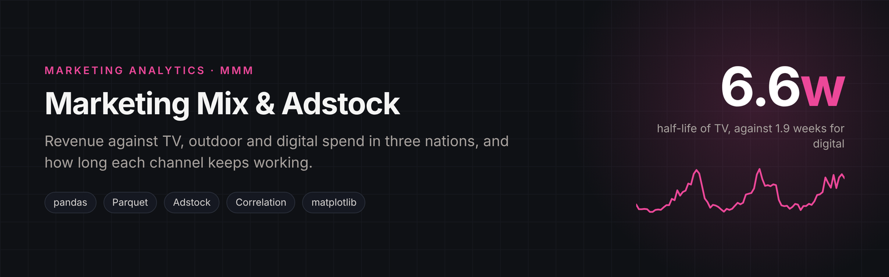
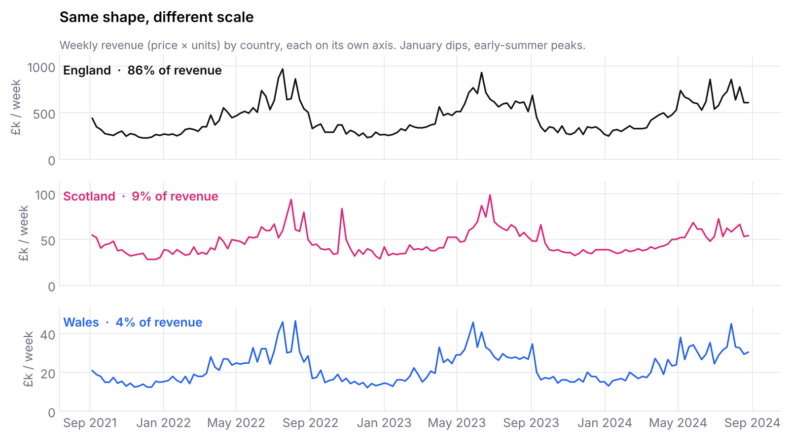
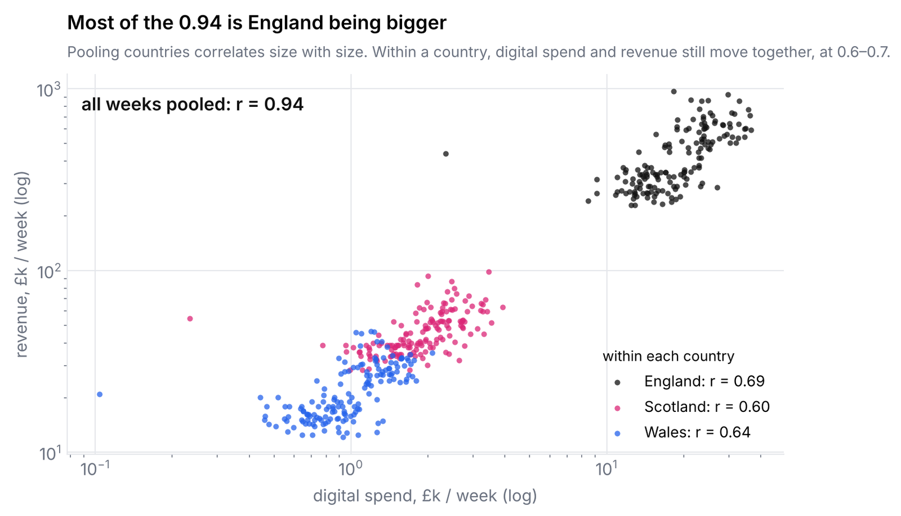
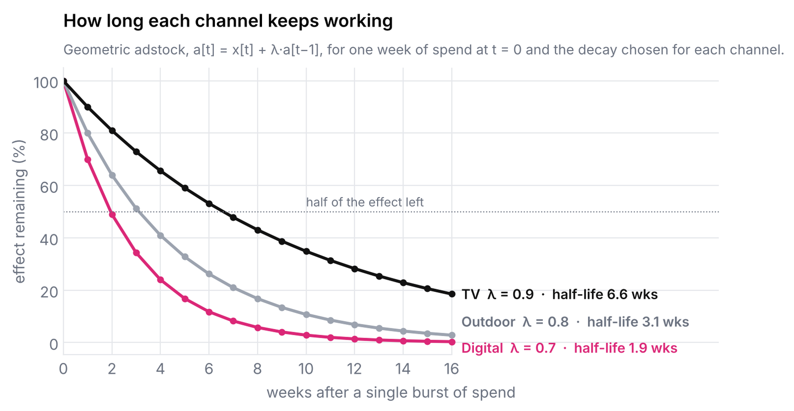
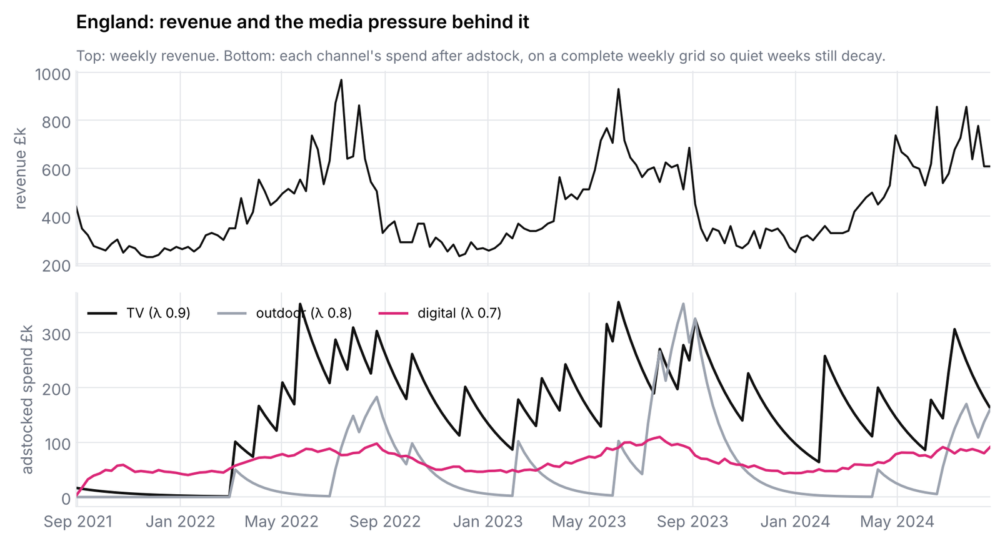

<p align="center"></p>

# Marketing Mix Analysis: Revenue, Media Spend and Adstock

How does media spend relate to revenue, and how long does each channel's effect last?
An exploratory marketing-mix analysis across England, Scotland and Wales, from raw extracts to
channel-specific adstock decay rates.

**Notebook:** [`marketing_mix_adstock.ipynb`](marketing_mix_adstock.ipynb)

## Data (`data/`)

| File | Grain | Content |
|---|---|---|
| `sales.csv` | week × region | units and average price (regions as ONS country codes) |
| `atl.json` | campaign burst × region | above-the-line spend: TV and outdoor |
| `digital.parquet` | day × region | digital spend |

## What the notebook does

1. Cleans and harmonises three formats (CSV, JSON, Parquet), decodes `E92000001` / `S92000003` /
   `W92000004` to England / Scotland / Wales, and builds weekly revenue = price × units.
2. Revenue by region and year, and weekly seasonality (January dips, early-summer peaks,
   campaign spikes).
3. Media spend by channel and region, aligned to ISO weeks and joined to revenue.
4. Correlation of weekly revenue with total and per-channel spend.
5. A geometric **adstock** transformation, `a[t] = x[t] + λ · a[t-1]`, its behaviour as λ → 1
   and t → ∞, and channel-specific decay choices.
6. Notes on scaling the pipeline to production.

<p align="center"></p>

## Findings

| | |
|---|---|
| Revenue share | England ≈ 86%, Scotland ≈ 9%, Wales ≈ 4% |
| Revenue vs total spend (weekly r) | England 0.38 · Scotland 0.38 · Wales 0.33 |
| Revenue vs channel spend, all weeks pooled (r) | digital 0.94 · outdoor 0.42 · TV 0.34 |
| Revenue vs digital spend, within each country (r) | England 0.69 · Scotland 0.60 · Wales 0.64 |
| Chosen decay (λ, half-life) | digital 0.70 (~2 wks) · outdoor 0.80 (~3 wks) · TV 0.90 (~7 wks) |

**Read the pooled correlation with care.** The 0.94 for digital stacks all three countries
together, and England has both far more revenue and far more spend. Split by country, the
relationship is still clearly positive but much weaker:

<p align="center"></p>

**Adstock.** Digital responds in the same week with a short memory; TV correlates weakly in
the same week because its effect is spread over the following weeks, which is exactly what a
longer decay models.

<p align="center"></p>

<p align="center"></p>
<p align="center"><sub>Charts rebuilt from <code>data/</code> with the notebook's own cleaning steps; every correlation above reproduces the notebook's output. The adstock panel reindexes each channel to a complete weekly grid first, so weeks without spend still decay.</sub></p>

## Run it

```bash
pip install -r requirements.txt
jupyter notebook marketing_mix_adstock.ipynb
```

## Next steps

Fit a regression or Bayesian MMM on adstocked, saturated spend (Hill curves) to estimate
channel ROI, and select λ by validation rather than by inspection. Model countries separately
or with region effects, so that size differences are not mistaken for media response. Apply
adstock on a complete weekly grid: the notebook runs it over the weeks that have spend, which
skips the decay between campaign bursts.
